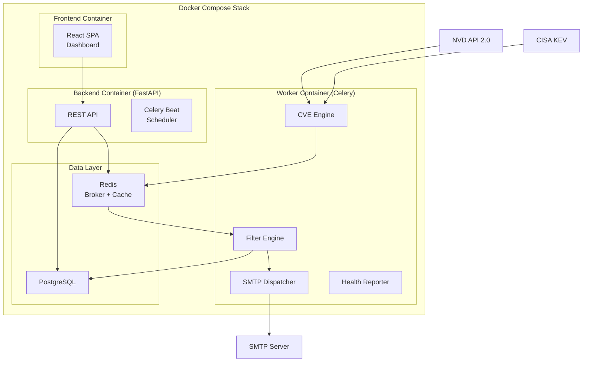

# AbuseCVE CTI Platform — Implementation Plan

A lightweight Cyber Threat Intelligence platform that scrapes trusted CVE sources, filters by vendor/product tags, alerts via SMTP, stores CVEs in a database, and supports knowledge article reports. Purple/black cybersecurity-themed UI with the logo **"AbuseCVE (≖_≖ )"**.

---

## Architecture Overview



### Component Responsibilities

| Component | Role |
|-----------|------|
| **FastAPI Backend** | REST API for dashboard, CRUD for filters/CVEs/KAs, configuration |
| **Celery Worker** | CVE fetching, filtering, dedup, SMTP dispatch, health reports |
| **Celery Beat** | Cron scheduler (configurable scan interval, daily health report) |
| **Redis** | Celery broker + CVE ingestion pool + caching layer |
| **PostgreSQL** | Persistent storage for CVEs, filters, KAs, config, health logs |
| **React SPA** | Dashboard with 8 tabs, purple/black theme |

---

## User Review Required

> [!IMPORTANT]
> **Tech stack choices that need confirmation:**
> 1. **PostgreSQL** over SQLite — better for concurrent workers and Docker. Acceptable?
> 2. **Celery + Redis** for task queue/scheduler — lightweight enough? Or prefer APScheduler (simpler, single-process)?
> 3. **React (Vite)** for frontend — or would you prefer a simpler vanilla HTML/JS SPA?
> 4. **AI-powered CVE summaries** — should I integrate an LLM API (OpenAI/Ollama) for auto-generating CVE descriptions in alerts, or use the raw NVD description?
> 5. **NVD API key** — the NVD API has rate limits (5 req/30s without key, 50 req/30s with key). Do you have an API key, or should I design for keyless operation?

---

## Proposed Changes

### 1. Project Structure

#### [NEW] Project Layout
```
AbuseCVE/
├── docker-compose.yml          # Full stack orchestration
├── .env.example                # Environment template
├── backend/
│   ├── Dockerfile
│   ├── requirements.txt
│   ├── alembic/                # DB migrations
│   │   ├── env.py
│   │   └── versions/
│   ├── app/
│   │   ├── main.py             # FastAPI app entry
│   │   ├── config.py           # Settings (Pydantic)
│   │   ├── database.py         # SQLAlchemy engine/session
│   │   ├── models/
│   │   │   ├── cve.py          # CVE model
│   │   │   ├── filter_rule.py  # Vendor/product filter
│   │   │   ├── knowledge_article.py
│   │   │   ├── alert_log.py
│   │   │   └── health_report.py
│   │   ├── api/
│   │   │   ├── routes_dashboard.py
│   │   │   ├── routes_filters.py
│   │   │   ├── routes_cves.py
│   │   │   ├── routes_alerts.py
│   │   │   ├── routes_ka.py
│   │   │   ├── routes_config.py
│   │   │   ├── routes_test.py
│   │   │   └── routes_health.py
│   │   ├── engine/
│   │   │   ├── sources/
│   │   │   │   ├── nvd.py      # NVD API 2.0 connector
│   │   │   │   ├── cisa_kev.py # CISA KEV feed
│   │   │   │   └── base.py     # Abstract source
│   │   │   ├── filter_engine.py
│   │   │   ├── dedup.py
│   │   │   └── pipeline.py     # Orchestrates fetch→pool→filter→dedup→alert
│   │   ├── services/
│   │   │   ├── smtp_service.py
│   │   │   ├── health_service.py
│   │   │   └── ka_service.py
│   │   └── tasks/
│   │       ├── celery_app.py
│   │       ├── cve_tasks.py    # Scheduled CVE scan
│   │       ├── health_tasks.py # Daily health report
│   │       └── init_tasks.py   # DB initialization (bulk import)
│   └── templates/
│       ├── alert_email.html
│       ├── health_report.html
│       └── knowledge_article.html
├── frontend/
│   ├── Dockerfile
│   ├── package.json
│   ├── vite.config.js
│   ├── index.html
│   └── src/
│       ├── main.jsx
│       ├── App.jsx
│       ├── index.css           # Purple/black theme
│       ├── components/
│       │   ├── Sidebar.jsx
│       │   ├── Header.jsx
│       │   ├── CVECard.jsx
│       │   ├── FilterBuilder.jsx
│       │   ├── AlertStream.jsx
│       │   └── ...
│       └── pages/
│           ├── Dashboard.jsx
│           ├── Filters.jsx
│           ├── Alerts.jsx
│           ├── CVEDatabase.jsx
│           ├── KnowledgeArticles.jsx
│           ├── Configuration.jsx
│           ├── TestPage.jsx
│           └── HealthReports.jsx
└── nginx/
    └── nginx.conf              # Reverse proxy
```

---

### 2. Database Schema

#### [NEW] [models/](file:///home/poro/Projects/AbuseCVE/backend/app/models)

**CVE Table** — stores every tracked CVE
```
cves: id, cve_id (unique), vendor, product, description, severity, cvss_score,
      source, published_date, modified_date, kev_flag, seen_count, first_seen,
      last_seen, alert_sent, raw_json
```

**Filter Rules** — defines what to monitor
```
filter_rules: id, vendor, product, enabled, min_cvss, max_cvss,
              severity_filter (LOW/MED/HIGH/CRITICAL), keywords, created_at
```

**Alert Log** — tracks sent alerts
```
alert_logs: id, cve_id (FK), sent_at, recipient, status, error_message
```

**Knowledge Articles**
```
knowledge_articles: id, title, cve_ids (JSON array), content (markdown),
                    author, created_at, updated_at
```

**Health Reports**
```
health_reports: id, report_date, components_status (JSON), new_cves_alerted,
               existing_cves_seen, errors, report_html, sent_at
```

**App Config** — key/value store for runtime config
```
app_config: key (PK), value (JSON), updated_at
```

---

### 3. Backend — CVE Engine

#### [NEW] [engine/sources/nvd.py](file:///home/poro/Projects/AbuseCVE/backend/app/engine/sources/nvd.py)
- Connects to `https://services.nvd.nist.gov/rest/json/cves/2.0`
- Supports `keywordSearch`, `cpeName`, `pubStartDate/pubEndDate` params
- Paginated fetching with rate limiting (respects API key or keyless limits)
- Returns normalized CVE objects

#### [NEW] [engine/sources/cisa_kev.py](file:///home/poro/Projects/AbuseCVE/backend/app/engine/sources/cisa_kev.py)
- Fetches `https://www.cisa.gov/sites/default/files/feeds/known_exploited_vulnerabilities.json`
- Flags CVEs in KEV catalog
- Returns normalized CVE objects

#### [NEW] [engine/pipeline.py](file:///home/poro/Projects/AbuseCVE/backend/app/engine/pipeline.py)
**Log Aggregation Pipeline:**
1. **Fetch** — Celery task pulls CVEs from all sources, pushes raw data to Redis list (the "pool")
2. **Filter** — Engine pops from pool, applies filter rules (vendor/product match, CVSS threshold, severity, keywords)
3. **Dedup** — Checks PostgreSQL: if CVE exists → increment `seen_count`, skip alert; if new → insert + flag for alert
4. **Dispatch** — New CVEs are queued for SMTP alert dispatch

#### [NEW] [engine/filter_engine.py](file:///home/poro/Projects/AbuseCVE/backend/app/engine/filter_engine.py)
- Loads active filter rules from DB
- Matches CVEs against each rule (vendor match → product match → CVSS range → severity → keyword filter)
- Fine-grained: "From Fortinet, only FortiEDR, FortiGate, FortiMail" with CVSS ≥ 7.0
- Returns list of matched CVEs with their matching rule

---

### 4. Backend — SMTP & Notifications

#### [NEW] [services/smtp_service.py](file:///home/poro/Projects/AbuseCVE/backend/app/services/smtp_service.py)
- Configurable SMTP host/port/user/pass/TLS via app config
- Sends HTML-formatted alert emails using Jinja2 templates
- Supports multiple recipients
- Logs every send attempt to `alert_logs`

#### [NEW] [templates/alert_email.html](file:///home/poro/Projects/AbuseCVE/backend/templates/alert_email.html)
- Purple/black branded template matching the platform theme
- Includes: CVE ID, severity badge, CVSS score, description, vendor/product, source links, KEV status

#### [NEW] [services/health_service.py](file:///home/poro/Projects/AbuseCVE/backend/app/services/health_service.py)
- Daily health check: DB connectivity, Redis connectivity, SMTP test, last successful scan time
- Generates report with: components status, CVEs alerted today, CVEs seen but already existed, errors/warnings
- Dispatches via SMTP at configured time (default: 23:59)

---

### 5. Backend — Knowledge Articles

#### [NEW] [services/ka_service.py](file:///home/poro/Projects/AbuseCVE/backend/app/services/ka_service.py)
- Create KA from selected CVEs
- Markdown content with CVE details, timeline, impact assessment
- Export to HTML/PDF-ready format using the KA template

---

### 6. Frontend — Dashboard SPA

#### [NEW] React SPA with 8 tabs

| Tab | Features |
|-----|----------|
| **Dashboard** | Stats cards (total CVEs, today's alerts, filters active), recent alerts stream, severity pie chart |
| **Filters** | Filter builder with vendor dropdown → product multi-select → CVSS range slider → severity checkboxes → keyword input; CRUD operations; enable/disable toggle |
| **Alerts** | Live alert feed, alert history table with pagination, detail view modal |
| **CVE Database** | Searchable/sortable table of all stored CVEs, detail view, export |
| **Knowledge Articles** | Create/edit/view KAs, select CVEs to include, markdown editor, preview |
| **Configuration** | SMTP settings, scan interval, API keys, recipient emails, health report schedule |
| **Test** | "Run Full Chain Test" button that triggers fetch→filter→dedup→alert flow with a test CVE; shows step-by-step results |
| **Health Reports** | Configure daily report time/recipients, view past reports, component status indicators |

#### Design System
- **Primary**: `#7C3AED` (vivid purple) → `#A855F7` (light purple)
- **Background**: `#0F0F1A` (near-black) → `#1A1A2E` (dark navy)
- **Cards**: `rgba(124, 58, 237, 0.08)` with glass-morphism blur
- **Accents**: Neon purple glows, gradient borders
- **Font**: Inter (Google Fonts)
- **Logo**: Purple shield with `(≖_≖ )` face

---

### 7. Docker & Infrastructure

#### [NEW] [docker-compose.yml](file:///home/poro/Projects/AbuseCVE/docker-compose.yml)
```yaml
services:
  postgres:     # PostgreSQL 16 - persistent storage
  redis:        # Redis 7 - Celery broker + CVE pool
  backend:      # FastAPI app (uvicorn)
  worker:       # Celery worker (CVE engine tasks)
  beat:         # Celery Beat (scheduler)
  frontend:     # Vite dev / Nginx production
  nginx:        # Reverse proxy (routes /api → backend, / → frontend)
```

**Resource limits**: Each container gets memory limits to prevent overconsumption.  
**Health checks**: Every service has a health check endpoint/command.  
**Restart policy**: `unless-stopped` for all services.

#### [NEW] [.env.example](file:///home/poro/Projects/AbuseCVE/.env.example)
- Database URL, Redis URL, SMTP credentials, NVD API key (optional), scan interval, recipients

---

## Verification Plan

### Automated Tests

1. **Backend unit tests** (pytest)
   ```bash
   docker compose exec backend pytest tests/ -v
   ```
   - Filter engine: test vendor/product matching, CVSS thresholds, keyword filters
   - Dedup logic: test new CVE insertion vs counter increment
   - Source connectors: test NVD/KEV response parsing with mocked data

2. **API endpoint tests** (pytest + httpx)
   ```bash
   docker compose exec backend pytest tests/test_api.py -v
   ```
   - CRUD for filters, CVEs, KAs
   - Config get/set
   - Test endpoint triggers pipeline

3. **Full pipeline integration test**
   ```bash
   docker compose exec backend python -m app.engine.pipeline --test
   ```
   - Fetches from real NVD API (small query)
   - Filters, deduplicates, and stores
   - Sends test alert email

### Manual Verification

1. **Docker stack startup**
   ```bash
   cd /home/poro/Projects/AbuseCVE && docker compose up --build
   ```
   - Verify all 7 containers are running and healthy

2. **Dashboard UI** — Open `http://localhost` in browser
   - Verify purple/black theme renders correctly
   - Navigate all 8 tabs
   - Create a filter rule (e.g., Fortinet → FortiGate, CVSS ≥ 7.0)
   - Click "Test Full Chain" and verify step-by-step results appear

3. **SMTP test** — Use the Test tab or Configuration tab to send a test email
   - Verify email arrives with correct template formatting

4. **DB initialization** — Click "Initialize DB" button
   - Verify past CVEs are pulled and stored for configured filters

5. **Health report** — Trigger manually or wait for scheduled time
   - Verify report email contains component status and CVE counts
