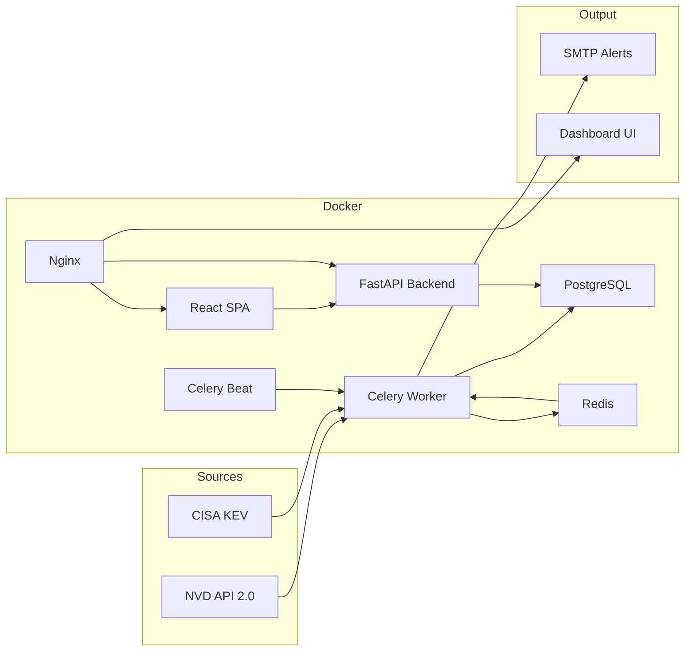

# AbuseCVE (≖_≖ ) — Build Walkthrough

## What Was Built

A complete Cyber Threat Intelligence platform across **59 files**, deployed via **Docker Compose** with 7 containers.

---

## Architecture



---

## Project Structure (59 files)

| Layer | Key Files | Purpose |
|-------|-----------|---------|
| **Infrastructure** | [docker-compose.yml](file:///home/poro/Projects/AbuseCVE/docker-compose.yml), [.env.example](file:///home/poro/Projects/AbuseCVE/.env.example) | 7-container stack with health checks |
| **CVE Engine** | [nvd.py](file:///home/poro/Projects/AbuseCVE/backend/app/engine/sources/nvd.py), [cisa_kev.py](file:///home/poro/Projects/AbuseCVE/backend/app/engine/sources/cisa_kev.py) | NVD local mirroring + CISA KEV feed |
| **Filter Engine** | [filter_engine.py](file:///home/poro/Projects/AbuseCVE/backend/app/engine/filter_engine.py) | Vendor/product/CVSS/severity/keyword matching |
| **Pipeline** | [pipeline.py](file:///home/poro/Projects/AbuseCVE/backend/app/engine/pipeline.py), [dedup.py](file:///home/poro/Projects/AbuseCVE/backend/app/engine/dedup.py) | Redis pool → filter → dedup → alert |
| **SMTP** | [smtp_service.py](file:///home/poro/Projects/AbuseCVE/backend/app/services/smtp_service.py) | Branded email alerts with Jinja2 templates |
| **Scheduler** | [celery_app.py](file:///home/poro/Projects/AbuseCVE/backend/app/tasks/celery_app.py), [cve_tasks.py](file:///home/poro/Projects/AbuseCVE/backend/app/tasks/cve_tasks.py) | Configurable scan interval + daily health |
| **API** | 8 route files in [api/](file:///home/poro/Projects/AbuseCVE/backend/app/api) | Full REST API for all features |
| **Frontend** | 8 pages + [index.css](file:///home/poro/Projects/AbuseCVE/frontend/src/index.css) | Purple/black cybersecurity SPA |

---

## Key Features Implemented

### 🔍 CVE Engine (NVD Local Mirroring)
- **Initial population**: Bulk fetch with max page size (2,000)
- **Incremental sync**: `lastModStartDate/lastModEndDate` every 2 hours
- **Rate limiting**: 50 req/30s with key, 5/30s without
- **CISA KEV**: Full catalog fetch with KEV flagging

### 🧲 Fine-Grained Filter Engine
- Vendor match (name + CPE + description search)
- Product list (e.g., "Fortinet → only FortiGate, FortiEDR, FortiMail")
- CVSS score range (min/max slider)
- Severity checkboxes (LOW/MEDIUM/HIGH/CRITICAL)
- Keyword include/exclude

### 📧 SMTP Alerting
- HTML-branded emails (purple/black theme)
- Severity badges, CVE details, KEV flags
- Alert logging with status tracking

### 💊 Daily Health Reports
- Component status (DB, Redis, SMTP, NVD API)
- Daily stats: new alerts, existing CVEs seen, totals
- Auto-dispatch via Celery Beat

### 📝 Knowledge Articles
- Auto-generated markdown from selected CVEs
- Severity assessment, recommendations, CISA KEV priority
- Draft/published workflow

### 🧪 Test Chain
- Individual component tests (SMTP, fetch, filter, pipeline)
- Full chain validation with step-by-step results

---

## How to Deploy

```bash
cd /home/poro/Projects/AbuseCVE

# 1. Configure environment
cp .env.example .env
# Edit .env with your NVD API key and SMTP credentials

# 2. Build and start all services
docker compose up --build -d

# 3. Access the dashboard
open http://localhost
```

### Container Ports
| Service | Port |
|---------|------|
| Nginx (proxy) | `80` |
| Frontend (direct) | `5173` |
| Backend API | `8000` |
| PostgreSQL | `5432` |
| Redis | `6379` |

---

## Quick Start Guide

1. Open `http://localhost` → **Dashboard**
2. Go to **Filters** → Create a filter (e.g., Fortinet → FortiGate, CVSS ≥ 7.0)
3. Go to **Configuration** → Set SMTP credentials and NVD API key
4. Go to **Test** → Run "Full Chain Test" to validate everything works
5. Click **Trigger Scan** on Dashboard to run first CVE sweep
6. Go to **Dashboard** → Click "Initialize Database" to pull past CVEs
